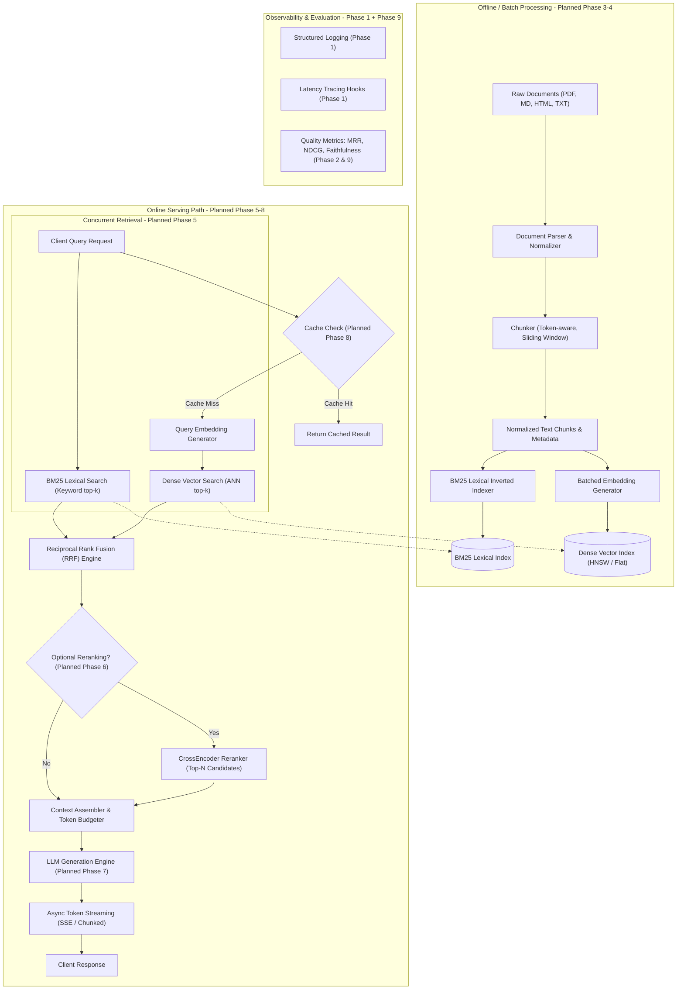
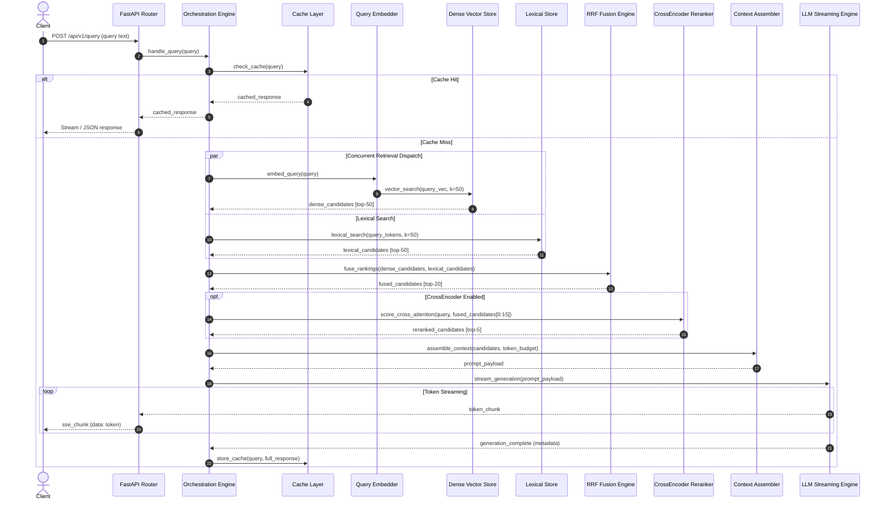
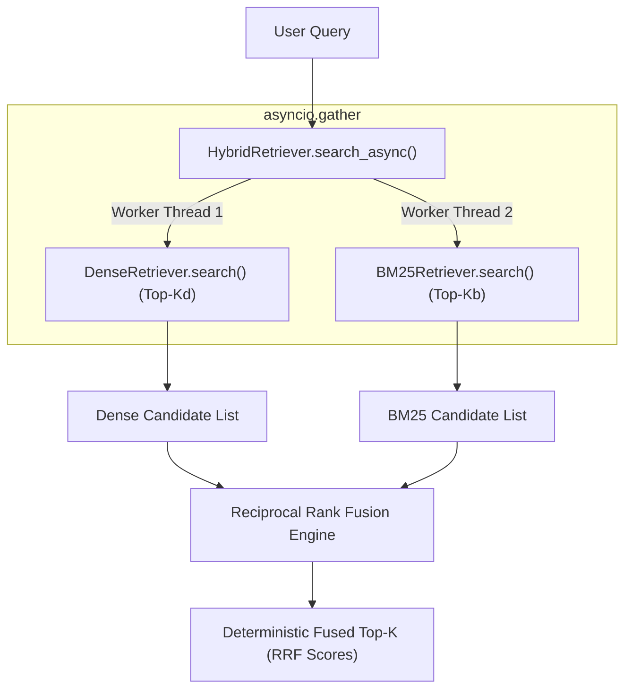
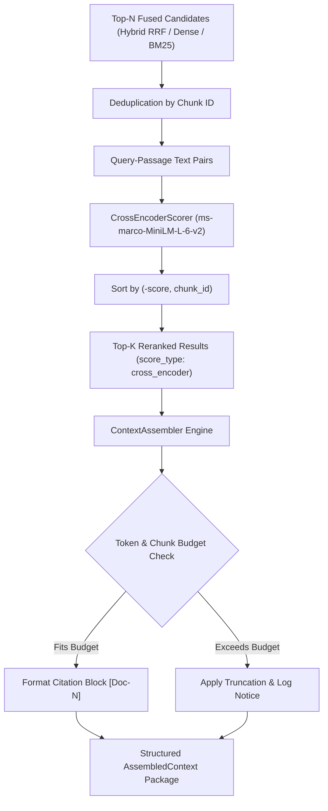
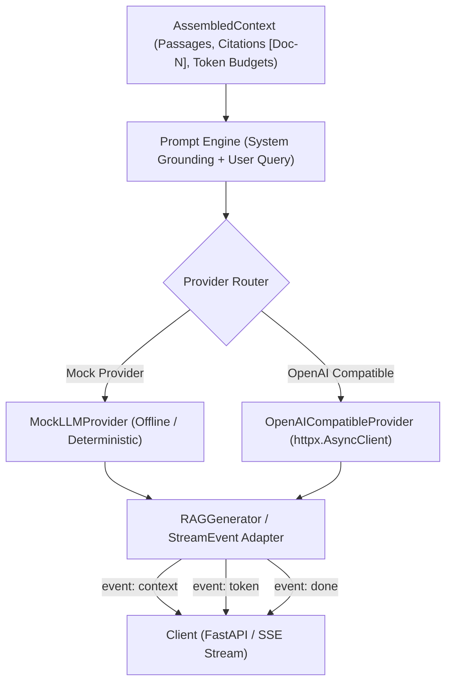

# FastRAG System Architecture Specification

## 1. Executive Summary & Design Philosophy

**FastRAG** is a performance-oriented Retrieval-Augmented Generation (RAG) architecture designed to minimize end-to-end request latency while maximizing retrieval recall, precision, and factual grounding.

The core architectural principles are:

1. **Strict Asynchronous Concurrency**: Parallelize non-dependent computational paths (e.g., concurrent dense and lexical candidate retrieval).
2. **Layered Candidate Funneling**: High-recall, low-latency candidate retrieval (Dense + BM25) fused via Reciprocal Rank Fusion (RRF), followed by optional precision-focused CrossEncoder reranking on a small candidate window ($k \le 10$).
3. **Decoupled Offline vs. Online Paths**: Isolate expensive ingestion, text normalization, chunking, and embedding generation from the latency-sensitive online serving path.
4. **End-to-End Observability**: Microsecond-granularity latency profiling per pipeline stage, structured logging without sensitive data leakage, and rigorous evaluation against retrieval and generation benchmarks.

> [!NOTE]
> This document specifies the planned architectural blueprint for FastRAG. Components are distinguished between **Implemented (Phase 1 Foundation)** and **Planned (Phases 2–10)**. No empirical performance improvements or benchmark figures are claimed at this stage.

---

## 2. Component Implementation Status

| Architecture Component | Status | Target Phase | Implementation Scope |
| :--- | :--- | :--- | :--- |
| Application Core & Config | **Implemented** | Phase 1 | FastAPI, Pydantic Settings, environment overrides |
| Health Check & Lifespan | **Implemented** | Phase 1 | `/health` endpoint, clean startup/shutdown hooks |
| Structured Logging & Latency Tracing | **Implemented** | Phase 1 | Standard logging, severity tags, `measure_latency` |
| Test Suite & Project Layout | **Implemented** | Phase 1 | Pytest suite, modular package boundaries |
| Dataset & Eval Harness | **Implemented** | Phase 2 | Benchmark corpora, query sets, retrieval metrics |
| Document Ingestion & Chunking | **Implemented** | Phase 3 | Loaders (JSONL/TXT), conservative normalization, boundary-aware chunking |
| Dense Vector & BM25 Retrieval | **Implemented** | Phase 4 | Exact cosine dot product (NumPy), SentenceTransformers, Okapi BM25, NPZ/JSON index formats |
| Concurrent Hybrid Retrieval | **Implemented** | Phase 5 | Asynchronous branch dispatch (`asyncio.gather`), timeout handling, strict & degraded modes |
| Reciprocal Rank Fusion (RRF) | **Implemented** | Phase 5 | Scale-invariant rank fusion ($k=60$), deterministic tie-breaking, deduplication |
| CrossEncoder Reranking | **Implemented** | Phase 6 | Transformer cross-attention scoring (`ms-marco-MiniLM-L-6-v2`) for top-$k$ |
| Context Assembly & Citations | **Implemented** | Phase 6 | Token budgeting, deduplication, structured citation markers (`[Doc-N]`) |
| End-to-End Pipeline Orchestration | **Implemented** | Phase 6 | Coordinated Retrieval -> Reranking -> Assembly with component timings |
| LLM Generation & Streaming | **Implemented** | Phase 7 | Grounded answer generation and real-time SSE streaming |
| Multilevel Caching | *Planned* | Phase 8 | Query cache & embedding vector cache |
| Load Testing & Optimization | *Planned* | Phase 9 | Latency percentiles, throughput benchmarking |

---

## 3. Planned Data Flow & System Architecture

### High-Level Architecture Diagram



---

## 4. Architectural Analysis: Concurrency vs. Sequential Dependencies

FastRAG explicitly isolates operations that must be strictly sequential from operations that can execute concurrently.

### A. Operations Requiring Upstream Results (Sequential Chains)

| Stage | Upstream Prerequisite | Justification |
| :--- | :--- | :--- |
| **Parsing $\to$ Chunking** | Raw Document Stream | Token boundaries and chunk offsets cannot be calculated until text is parsed and normalized. |
| **Chunking $\to$ Indexing** | Normalized Chunks | Neither dense vectors nor BM25 inverted lists can be built without deterministic chunk identifiers. |
| **Dense Search $\to$ Query Embedding** | Query Vector | Vector similarity search cannot execute until the user query string is embedded. |
| **RRF Fusion $\to$ Retrieval Outputs** | Dense & Lexical Candidate Lists | Reciprocal Rank Fusion mathematically requires both rank lists before computing composite scores. |
| **CrossEncoder Rerank $\to$ RRF Candidate Pool** | Fused Candidate Pool | Cross-encoders are computationally intensive ($O(N \cdot L^2)$) and must only score the top-$N$ pre-filtered candidates ($N \le 20$). |
| **Context Assembly $\to$ Reranked Passages** | Top-$K$ Ranked Passages | The token budget allocator cannot pack context until passage relevance ordering is finalized. |
| **LLM Generation $\to$ Assembled Prompt** | Prompt with System & Context | Generation cannot commence until the prompt context and citation tags are compiled. |

### B. Operations Executing Concurrently (Parallel Paths)

| Concurrent Operation Pair | Mechanism | Phase | Latency Rationale |
| :--- | :--- | :--- | :--- |
| **Dense Vector Search + BM25 Lexical Search** | Python `asyncio.gather()` | Phase 5 | Executing dense search ($~10\text{--}30\text{ms}$) and lexical search ($~5\text{--}15\text{ms}$) concurrently avoids serial latency accumulation ($\Sigma \Delta t \to \max(\Delta t_{\text{dense}}, \Delta t_{\text{lexical}})$). |
| **Batch Embedding Generation during Ingestion** | Batched matrix operations / Async worker pools | Phase 3 | Ingestion encodes chunks in batches (e.g., 32–128 items) overlapping I/O with GPU/CPU matrix multiplication. |
| **Dense Indexing + Lexical Indexing during Ingestion** | Background tasks / Multiprocessing | Phase 3–4 | BM25 token posting construction and vector index insertion operate on separate memory structures independently. |
| **Token Generation + Stream Transmission** | Asynchronous Generators / HTTP Streaming | Phase 7 | Tokens are flushed to the client socket as generated, minimizing Time to First Token (TTFT). |

---

## 5. Detailed Component Specifications

### 5.1. Document Ingestion (Offline - Implemented Phase 3)
- Supports JSONL corpora (`corpus.jsonl`) and plain-text (`.txt`) documents, with directory discovery via `loaders.py`.
- Enforces strict input validation: non-empty `document_id`, string types, and JSON-serializable `metadata` via `validation.py`.
- Memory-efficient streaming (`load_jsonl_stream`) avoids loading massive datasets into memory at once.
- Preserves raw source text as `raw_text` for complete provenance and auditing.

### 5.2. Document Normalization and Chunking (Offline - Implemented Phase 3)
- Conservative text normalization (`normalization.py`):
  - Canonical Unicode composition (`NFC`).
  - Strips null characters (`\x00`).
  - Standardizes line breaks (`\r\n`, `\r` $\to$ `\n`).
  - Collapses horizontal whitespace while preserving paragraph boundaries (`\n\n`).
  - Strictly preserves casing, punctuation, technical identifiers, code syntax, mathematical notations, and URLs.
- Boundary-aware, deterministic chunker (`chunking.py`):
  - Configurable `chunk_size` (default: 1,000 characters) and `chunk_overlap` (default: 150 characters).
  - Preference-ordered breakpoint seeking: Paragraph (`\n\n`) $\to$ Line (`\n`) $\to$ Sentence (`. `, `? `, `! `) $\to$ Word (` `).
  - Exact character offset tracking guaranteeing `doc_text[start_offset:end_offset] == chunk.text`.
  - Content-addressed deterministic chunk IDs: `{document_id}#c{chunk_index:04d}_{sha256[:12]}`.
  - Atomic JSONL export (`pipeline.py`) preventing corrupt partial outputs during processing runs.

### 5.3. Embedding Generation and Vector Indexing (Offline/Online - Planned Phases 3–4)
- **Offline**: Generates dense embeddings for all chunk texts using an optimized embedding model; builds an Approximate Nearest Neighbor (ANN) index (e.g., HNSW).
- **Online**: Generates dense embedding for incoming query string with minimal overhead.
- Normalizes embedding vectors to unit length ($\ell_2$) allowing dot-product calculation for cosine similarity.

### 5.4. BM25 Lexical Indexing (Offline/Online - Planned Phases 3–4)
- Tokenizes, stems, and filters stop words to create an inverted index.
- Computes term frequencies ($TF$) and inverted document frequencies ($IDF$) with tunable parameters:
  - $k_1 \in [1.2, 2.0]$ (term frequency saturation).
  - $b \in [0.5, 0.8]$ (document length normalization).
- Online phase evaluates BM25 scores for query terms against posting lists.

### 5.5. Concurrent Dense and Lexical Retrieval (Online - Planned Phase 5)
- Orchestrates simultaneous retrieval requests using non-blocking asynchronous execution.
- Dispatches query embedding and dense vector search on one asynchronous task.
- Dispatches query tokenization and lexical inverted index search on a concurrent task.
- Collects candidate sets (e.g., top-$K_{\text{dense}} = 50$, top-$K_{\text{lexical}} = 50$) under a unified timeout deadline.

### 5.6. Reciprocal Rank Fusion (RRF) (Online - Planned Phase 5)
- Merges disparate score distributions without requiring score calibration or min-max normalization.
- RRF score formula for document $d$:
  $$RRF(d) = \sum_{m \in M} \frac{1}{k + r_m(d)}$$
  where $M = \{\text{dense}, \text{lexical}\}$, $r_m(d)$ is the 1-based rank of document $d$ in retrieval system $m$, and $k$ is a smoothing constant (standard default $k = 60$).
- Fast sort of combined candidate pool, yielding top-$N$ fused candidates (e.g., $N = 20$).

### 5.7. Optional CrossEncoder Reranking (Online - Planned Phase 6)
- Evaluates full query-passage cross-attention for the top-$N$ candidates output by RRF.
- Computes non-linear semantic relevance scores.
- Configurable bypass toggle: when low latency is strictly prioritized over marginal precision gains, CrossEncoder can be dynamically bypassed based on request parameters.
- Limits reranking batch size ($N \le 10\text{--}20$) to constrain inference latency.

### 5.8. Context Assembly and Source Tracking (Online - Planned Phase 6)
- Enforces strict token budgeting to prevent LLM context window overflow and reduce generation latency.
- Deduplicates redundant chunks derived from the same source passage.
- Prepares structured context blocks annotated with unique citation keys: `[Doc1]`, `[Doc2]`.
- Assembles prompt with system directives, citation requirements, and formatted context passages.

### 5.9. LLM Generation and Streaming (Online - Planned Phase 7)
- Invokes LLM API/engine asynchronously with prompt parameters (temperature, max tokens).
- Streams tokens immediately to client via Server-Sent Events (SSE) or chunked HTTP transfer.
- Tracks Time To First Token (TTFT) and Total Generation Latency (TGL).
- Validates answer formatting and citation markers.

### 5.10. Multilevel Caching (Online - Planned Phase 8)
- **Level 1 (Query Cache)**: Exact or semantic match cache for frequent queries, bypassing the entire retrieval and generation pipeline.
- **Level 2 (Embedding Cache)**: In-memory cache for query string embeddings, eliminating redundant encoder inference for repeated or near-identical queries.
- Cache invalidation strategies based on index mutation versioning and TTL policies.

### 5.11. Observability and Performance Evaluation (Continuous - Phase 1 Foundation & Phase 9)
- **Phase 1 Foundation**:
  - Centralized logging with timestamps, logger hierarchy, and log level filtering.
  - Contextual latency measurement context manager (`measure_latency`).
  - Safe logging policies strictly forbidding plaintext credentials or document payloads.
- **Phase 9 Target**:
  - P50, P90, P95, and P99 latency percentiles recorded per subsystem.
  - Retrieval quality evaluated via MRR@k, NDCG@k, Recall@k.
  - Generation quality evaluated via Faithfulness, Answer Relevance, and Citation Grounding.

---

## 6. Online Query Sequence Flow (Planned)



---

## 8. Phase 4 Retrieval Engines Specification

### A. Shared Retrieval Abstraction (`backend/app/retrieval/base.py`)

Both retrievers implement the abstract base class `BaseRetriever`:

```python
class BaseRetriever(ABC):
    @abstractmethod
    def build_index(self, chunks: Sequence[Chunk]) -> IndexInfo: ...
    @abstractmethod
    def search(self, query: str, top_k: int = 10) -> list[RetrievalResult]: ...
    @abstractmethod
    def save_index(self, directory_path: Path | str) -> None: ...
    @abstractmethod
    def load_index(self, directory_path: Path | str) -> IndexInfo: ...
    @abstractmethod
    def get_index_info(self) -> IndexInfo | None: ...
    @property
    @abstractmethod
    def is_indexed(self) -> bool: ...
```

- **Candidate Normalization**: Every candidate hit is returned as a typed `RetrievalResult(chunk_id, document_id, rank, score, score_type, text, source, metadata)`.
- **Deterministic Tie-Breaking**: When two candidates produce identical retrieval scores, ordering is broken deterministically by sorting on `chunk_id` ascending.
- **Corpus Fingerprinting**: Index metadata records a SHA-256 fingerprint computed across sorted `(chunk_id, text)` pairs to guard against corpus drift.

### B. Lexical Search Engine: `BM25Retriever` (`backend/app/retrieval/bm25.py`)

- **Scoring**: Robertson-Spärck Jones Okapi BM25 formulation with standard hyperparameters ($k_1 = 1.5, b = 0.75$).
- **Tokenization**: Regex tokenizer preserving technical identifiers, dotted library paths (e.g. `asyncio.gather`), hyphenated words (`bi-encoder`), and code tokens.
- **Index Storage**: Atomic single-file JSON serialization (`bm25_index.json`) capturing inverted index frequencies, document lengths, average document length, vocabulary, and chunk payloads.

### C. Dense Semantic Search Engine: `DenseRetriever` (`backend/app/retrieval/dense.py`)

- **Vector Model**: `sentence-transformers/all-MiniLM-L6-v2` producing normalized 384-dimensional dense vectors.
- **Similarity Metric**: Exact cosine dot product executed as matrix-vector multiplication in NumPy (`np.dot(vectors, query_vec)`).
- **Lazy Initialization**: Model weights are loaded lazily on the first encoding call, preferring locally cached weights (`local_files_only=True`) to eliminate redundant remote network calls in sandboxed environments.
- **Testing Interface**: `MockEmbeddingEncoder` produces deterministic float32 vectors derived from text hashes, allowing fast, offline unit testing.
- **Index Storage**: Atomic compressed NumPy archive (`dense_vectors.npz`) for embeddings paired with JSON metadata (`dense_meta.json`).

### D. Benchmark Adapter & Latency Profiling (`evaluation/retriever_adapter.py`)

- **Bridges to Evaluation Harness**: Evaluates retrievers against `datasets/queries.jsonl` and `datasets/qrels.tsv`, outputting standardized `EvaluationReport` JSON files.
- **Latency Segmentation**: Explicitly records cold-start latency (including one-time model initialization) separately from warm query execution distributions (mean, p50, p95, p99).

---

## 9. Phase 5 Concurrent Hybrid Retrieval & Reciprocal Rank Fusion

### A. Concurrency Model (`backend/app/retrieval/hybrid.py`)

Because underlying dense and lexical retrievers perform synchronous CPU-bound operations (NumPy vector matrix multiplication and BM25 inverted index token scoring), `HybridRetriever` schedules each branch in worker threads via Python's `asyncio.to_thread`.



- **Overlap Verification**: Branch execution times overlap in parallel. Total wall-clock duration is bounded by $\max(\Delta t_{\text{dense}}, \Delta t_{\text{bm25}}) + \Delta t_{\text{fusion}}$.
- **Failure Isolation**: Supports two operational modes:
  1. `strict`: Any branch error or timeout raises `RetrievalError` or `BranchTimeoutError`.
  2. `degraded`: If one branch fails or times out, the surviving branch's candidates are returned with `diagnostics.degraded = True`.

### B. Reciprocal Rank Fusion Formula (`backend/app/retrieval/fusion.py`)

To eliminate numerical distribution disparities between unbounded positive BM25 scores $[0, \infty)$ and bounded cosine similarities $[-1.0, 1.0]$, FastRAG applies rank-based Reciprocal Rank Fusion:

$$\operatorname{RRF}(d) = \sum_{r \in R} \frac{1}{k + \operatorname{rank}_r(d)}$$

Where:
- $R = \{\text{dense}, \text{bm25}\}$ is the set of retrieval branches.
- $k = 60$ is the standard smoothing parameter preventing top-ranked candidates from dominating completely.
- $\operatorname{rank}_r(d) \in \{1, 2, \dots, K_r\}$ is the 1-based rank position of chunk $d$ in branch $r$. If absent, contribution is 0.
- **Tie-Breaking Determinism**: Tied candidates are sorted strictly by `chunk_id` ascending.
- **Duplicate Protection**: Multiple occurrences of a chunk within one branch cannot inflate its contribution.

---

## 10. Phase 6 CrossEncoder Reranking & Context Assembly Subsystem

### A. Two-Tier Funneling Architecture

While first-stage hybrid retrieval maximizes candidate recall across lexical and semantic spaces, reciprocal rank fusion operates on ordinal ranks without joint token-level interaction. Phase 6 introduces full cross-attention reranking over the top-$N$ fused window ($N \approx 20$) followed by token-budgeted context formatting:



### B. CrossEncoder Reranker Specification (`backend/app/retrieval/reranker.py`)

- **Interface Abstraction**: `CrossEncoderScorer` ABC decouples neural model dependencies from business logic.
  - `SentenceTransformerCrossEncoder`: Lazily loads `cross-encoder/ms-marco-MiniLM-L-6-v2` with local cache precedence and instance reuse across queries.
  - `MockCrossEncoderScorer`: Deterministic, zero-dependency scorer using cryptographic hash and token overlap for offline development and fast CI testing.
- **Scoring Semantics**: Scores represent unbounded cross-attention logit outputs suitable for ordinal reordering.
- **Provenance Preservation**: Original retrieval scores, retriever types, and RRF ranks are preserved in `metadata['original_score']`, `metadata['original_rank']`, and `metadata['original_score_type']`.
- **Duplicate Elimination**: Unique chunk IDs are filtered prior to scoring, ensuring identical passages are never scored redundantly.
- **Deterministic Tie-Breaking**: Breaks identical score ties deterministically by `chunk_id` ascending.

### C. Context Assembler Specification (`backend/app/retrieval/context_assembler.py`)

- **Token Budgeting**: Strictly constrains prompt context using documented heuristic token counting:
  $$\text{tokens} \approx \max(\lceil \text{chars} / 4.0 \rceil, \lceil \text{words} \times 1.3 \rceil)$$
- **Structured Citations**: Assigns deterministic 1-indexed citation tags (`[Doc-1]`, `[Doc-2]`, etc.) based on final selected rank.
- **Deduplication Engine**: Discards exact text duplicates and redundant chunk IDs, ensuring context compactness.
- **Source Diversity**: Optional `max_chunks_per_document` parameter prevents a single document from consuming the entire context budget.
- **Explicit Truncation Reporting**: Records all truncation decisions, budget limits, and omitted candidate counts in `AssembledContext.truncation_reasons`.

### D. End-to-End Orchestrator (`backend/app/retrieval/pipeline.py`)

`RAGPipeline` provides unified asynchronous (`execute_async`) and synchronous (`execute`) coordination:
- Manages stage-by-stage timings: `retrieval_ms`, `rerank_ms`, `assembly_ms`, and `total_ms`.
- Fully satisfies `BaseRetriever`, allowing drop-in evaluation with existing benchmarks.
- Supports bypass modes for latency-sensitive queries or offline evaluation without model loading.

---

## 11. LLM Answer Generation & Real-Time Streaming Architecture (Phase 7)



### A. Grounded Prompt Engineering (`backend/app/generation/prompts.py`)
- **Strict Anti-Hallucination Guidelines**: Enforces that generated answers rely *exclusively* on retrieved context.
- **Citation Anchors**: Instructs the model to append `[Doc-N]` references immediately after factual statements.
- **Insufficient Evidence Protocol**: Mandates standardized refusal (`"The provided context does not contain sufficient information to answer this question."`) when evidence is absent, setting `context_insufficient = True`.
- **Indirect Prompt Injection Defense**: Treats context passages as passive untrusted data, refusing to execute instructions embedded within document chunks.

### B. Pluggable Provider Abstraction (`backend/app/generation/providers.py`)
- `LLMProvider(ABC)`: Standardized contract exposing `generate(request)` and `stream(request)`.
- `MockLLMProvider`: Zero-dependency, offline generator supporting token rate simulation and error injection for robust unit/integration testing.
- `OpenAICompatibleProvider`: Async client leveraging `httpx.AsyncClient` supporting OpenAI, vLLM, Ollama, LocalAI, and other OpenAI-compatible endpoints with SSE delta parsing.

### C. Server-Sent Events (SSE) Protocol (`backend/app/api/v1/routes.py`)
- Real-time incremental token streaming over `POST /api/v1/query/stream` with `text/event-stream`.
- Emits structured events:
  - `context`: Assembled passages, token count, and retrieval latency.
  - `token`: Individual text deltas (`delta`, `is_first`, `is_final`).
  - `done`: Final finish reason, cited document IDs, token usage, and total pipeline latency.
  - `error`: Structured error payloads on failure without crashing the ASGI worker.


