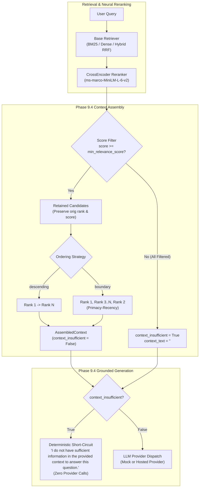

# FastRAG Phase 9.4: Evidence-Grounded Context Assembly & Abstention Architecture Design

**Document Version**: `1.0.0`  
**Date**: October 17, 2026  
**Status**: Approved & Implemented  
**Project**: FastRAG (`/Users/thakurveersingh/Documents/fastrag`)  

---

## 1. Motivation and Problem Statement

Prior to Phase 9.4, FastRAG operated as an unconstrained candidate-to-prompt funnel:
1. **Unconstrained Retrieval Noise on Unanswerables**:
   When given queries unanswerable from the knowledge corpus (such as negative counterfactuals or out-of-domain technical questions), retrievers (BM25, Dense, Hybrid RRF, and CrossEncoder) still surfaced the top-$k$ highest-scoring candidates. Despite CrossEncoder reranking yielding deeply negative logits ($-6.94$ to $-9.29$), the `ContextAssembler` packed these chunks unconditionally into the prompt up to the configured token budget.
2. **Generator Vulnerability to Hallucination**:
   Because context always contained chunks, downstream generators (and `MockLLMProvider`) attempted to answer from irrelevant passages, resulting in **0.0% unanswerable abstention accuracy**.
3. **Lost-in-the-Middle Attention Degradation**:
   Chunks were packed strictly in descending rank order ($1 \to N$). In larger prompts, secondary evidence located in the middle suffered from known LLM attention decay relative to prompt boundaries.

Phase 9.4 resolves these issues through evidence-grounded relevance filtering, boundary-first context layout, and deterministic pipeline abstention.

---

## 2. Architectural Design



---

## 3. Detailed Component Specifications

### 3.1 `AssembledContext` & `ContextAssembler`
Located at [`backend/app/retrieval/context_assembler.py`](file:///Users/thakurveersingh/Documents/fastrag/backend/app/retrieval/context_assembler.py).

#### `AssembledContext` Schema Extension
Added explicit insufficiency flag:
- `context_insufficient: bool = False`: Indicates whether no retrieved candidate passed the relevance threshold or no candidates were provided. Serialized in `to_dict()`.

#### Relevance Score Thresholding (`min_relevance_score`)
- Type: `float | None` (default: `None`).
- Backward Compatibility: When `None`, no score filtering occurs; all candidates within token/chunk budgets are retained.
- Filtering Behavior: Any candidate with `cand.score < min_relevance_score` is dropped and recorded in `truncation_reasons`.
- Insufficiency Trigger: If all candidates are filtered out (or if `candidates` is empty), `context_insufficient` is set to `True`, `context_text` is set to `""`, and `selected_chunks` is empty.
- Provenance Preservation: Retained chunks preserve their exact original `cand.rank`, `cand.score`, `rerank_score`, and `citation_id`.

#### Boundary-First Layout (`ordering_strategy`)
- Type: `Literal["descending", "boundary"]` (default: `"descending"`).
- Strategies:
  - `"descending"`: Traditional rank-ordered layout ($c_1, c_2, \dots, c_k$).
  - `"boundary"`: Mitigates lost-in-the-middle degradation by placing the highest-scoring candidate at the very start of the context block and the second highest-scoring candidate at the very end:
    - $k = 0$: `[]`
    - $k = 1$: `[c1]`
    - $k = 2$: `[c1, c2]`
    - $k \ge 3$: `[c1] + c[2:] + [c2]`
- Candidate ranks and scores on `ContextChunk` remain invariant; only the visual/textual placement within the prompt changes.

### 3.2 Grounded Answer Generation & Deterministic Abstention
Located at [`backend/app/generation/generator.py`](file:///Users/thakurveersingh/Documents/fastrag/backend/app/generation/generator.py).

#### Exact Canonical Abstention String
```python
INSUFFICIENT_CONTEXT_ANSWER = (
    "I do not have sufficient information in the provided context to answer this question."
)
```

#### Provider Short-Circuit
In both `generate_answer()` and `stream_answer()`:
- If `context.context_insufficient` is `True` or `not context.context_text.strip()`:
  - Immediately return or stream `INSUFFICIENT_CONTEXT_ANSWER`.
  - Set `context_insufficient = True` on `GenerationResponse`.
  - Set `cited_doc_ids = []`.
  - Set `usage = UsageStats(prompt_tokens=0, completion_tokens=14, total_tokens=14, is_estimated=True)`.
  - **Zero LLM provider calls are made**, completely avoiding API quota consumption, network latency, and third-party provider costs.

### 3.3 `MockLLMProvider` Updates
Located at [`backend/app/generation/providers.py`](file:///Users/thakurveersingh/Documents/fastrag/backend/app/generation/providers.py).
- Checks `request.metadata.get("context_insufficient")` or empty context text.
- Returns the exact canonical abstention answer.
- Propagates `context_insufficient = True`.

### 3.4 `RAGPipeline` End-to-End Orchestration
Located at [`backend/app/retrieval/pipeline.py`](file:///Users/thakurveersingh/Documents/fastrag/backend/app/retrieval/pipeline.py).
- Accepts `min_relevance_score` and `ordering_strategy` overrides in `execute()`, `execute_async()`, and `execute_stream_async()`.
- Incorporates `min_relevance_score` and `ordering_strategy` into the Tier 1 Query Cache key ([`backend/app/caching/query_cache.py`](file:///Users/thakurveersingh/Documents/fastrag/backend/app/caching/query_cache.py)) to ensure parameter isolation across cache lookups.

---

## 4. Score Semantics & Calibration Analysis

### 4.1 Score Scales Across FastRAG Retrievers

| Component | Score Metric | Mathematical Range | Empirical Distribution on Dev |
|---|---|---|---|
| **BM25 Retreiver** | Robertson-Spärck Jones BM25 | $[0, +\infty)$ | $4.5$ to $28.0$ |
| **Dense Retriever** | MiniLM-L6 Cosine Similarity | $[-1.0, 1.0]$ | $0.25$ to $0.85$ |
| **Hybrid RRF** | Reciprocal Rank Fusion | $(0, 0.033]$ | $0.012$ to $0.032$ |
| **CrossEncoder** | ms-marco-MiniLM-L-6-v2 raw logit | $(-\infty, +\infty)$ | $-9.5$ to $+9.5$ |

### 4.2 Calibration Limitations & Why Default is `None`
1. **Uncalibrated Neural Logits**: Cross-encoder scores are raw unnormalized logits output by the classification head. While their ordinal ranking is well-calibrated for passage comparison, the raw score magnitude shifts based on query length, syntax, and domain vocabulary.
2. **Heterogeneous Retrieval Pipelines**: If FastRAG runs in BM25-only or Dense-only mode (bypassing CrossEncoder), a logit-based threshold like $0.0$ or $-2.0$ would be completely inappropriate (filtering out all Dense/RRF candidates or none of BM25).
3. **Architectural Choice**: For these reasons, `min_relevance_score` defaults to `None` across all settings. When configured for a CrossEncoder-reranked pipeline, developmental calibration demonstrates:
   - **Dev Answerable Top-1 Logits**: $+6.98$ to $+9.03$.
   - **Dev Unanswerable Top-1 Logits**: $-6.94$ to $-9.29$.
   - **Operating Margin**: A threshold of $\tau = -2.0$ provides an $8$-point margin from unanswerable false positives while retaining secondary supporting evidence for answerable queries.
